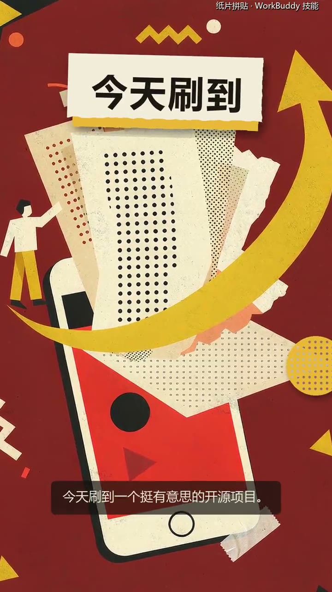
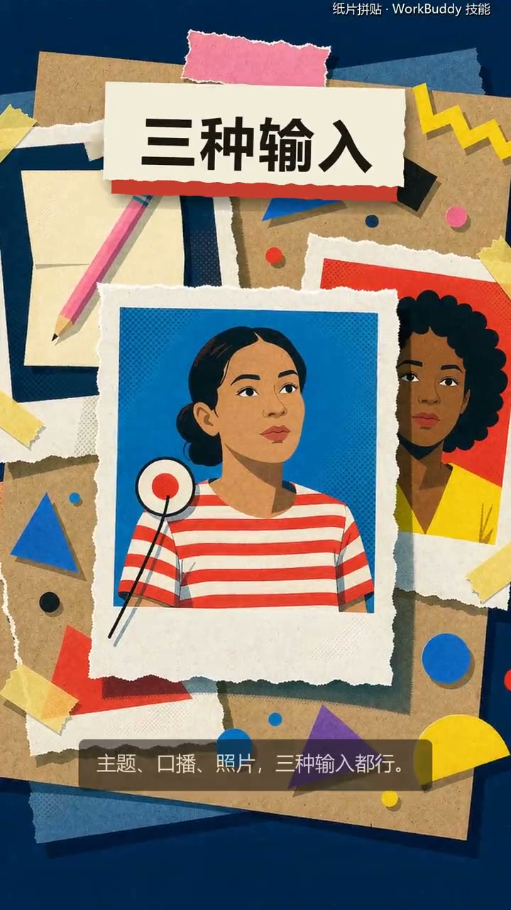
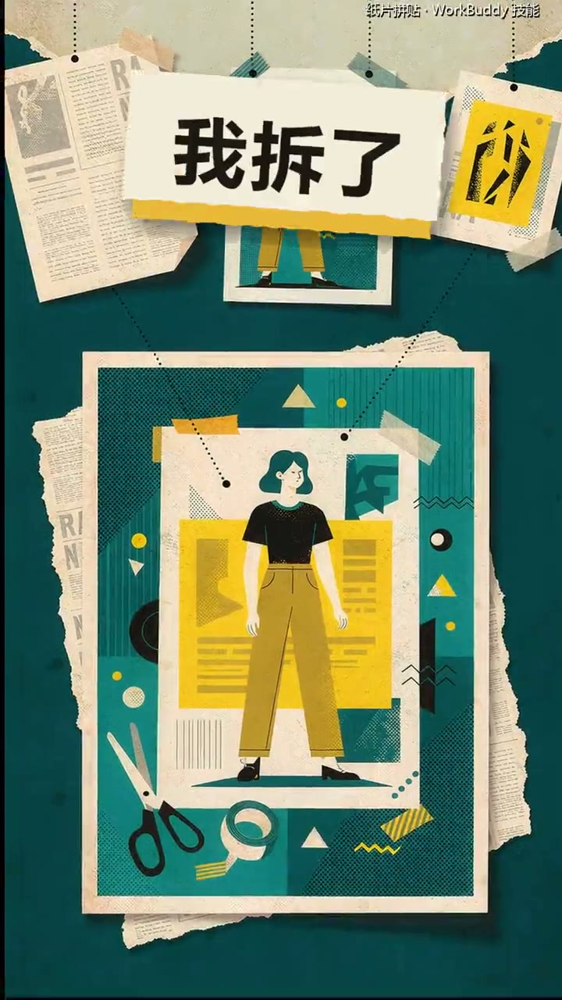
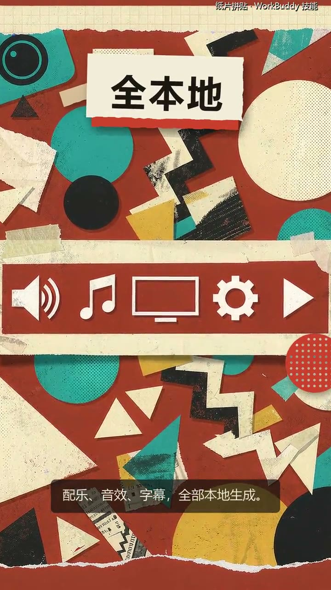

# 纸片拼贴 · 讲解片生成器

把一个主题做成一条 **Vox 风格的纸片拼贴解说片**：AI 只负责生成海报，纸片飞入、标题拍入、镜头缓推、转场、配音、配乐、字幕全部在本地跑。

给一个主题，出一条 15–60 秒的竖屏或横屏短片。**全程零视频 API，只有生图消耗额度。**

> **这个项目是从 [Alisa0808/vox-director](https://github.com/Alisa0808/vox-director) 改造来的。**
> 原项目是好东西，但它绑在 Claude Code + Atlas Cloud 付费接口上。
> 这里做的事情是：把调用付费接口的部分全部换成本地实现，让它在 WorkBuddy 里也能跑，而且几乎不花钱。
> **不是官方版本，也不代表原作者的任何立场。** 原项目 MIT 授权，详见 [LICENSE](LICENSE)。

## 效果

下面这条 40 秒的片子**就是这个技能自己做出来的**——它自己的介绍片：

   

[▶ 看完整演示（40 秒 / 3.1 MB）](docs/demo.mp4)

## 和原项目的关系

| | 原项目 vox-director | 本项目 |
|---|---|---|
| 运行宿主 | Claude Code / Codex | **WorkBuddy**（也兼容 Claude Code） |
| 出图 | Atlas Cloud · nano-banana-2 | **宿主自带的 ImageGen 工具** |
| 动效 | gemini-omni-flash 图生视频 | **Pillow 本地逐帧引擎**，零调用 |
| 配音 | xai/tts-v1 | **edge-tts**，免费无需 key |
| 配乐 | minimax/music-2.6 | **程序化合成**，或挂你自己的曲子 |
| 拼装 | 本地 ffmpeg | 本地 ffmpeg |
| 一条片子的成本 | 十几美元 | **只有出图额度，约 25–50 credits** |

**代码是重写的，不是 fork 改的。** 沿用下来的是方法论、流程编排和海报 prompt 的写法定式——这些是原项目真正有价值的部分，也是 MIT 允许沿用的部分。

## 为什么这样做

纸片拼贴的动态本质是「纸片啪一下拍上去、弹一下、镜头缓缓推」。这种动作**代码做得比视频模型更准**：纸片边缘永远清晰，字形永远稳定。视频模型反而经常把剪纸糊成塑料，而且每段 5 秒就要几十上百 credits。

所以把最贵的一环换掉，画质反而更好，成本降了一个数量级。

## 装

需要 Python 3.9+，以及一个能跑的 WorkBuddy。

```bash
# 1. 把整个 folder 放进技能目录
#    Windows: C:\Users\<你>\.workbuddy\skills\
#    macOS:   ~/.workbuddy/skills/

# 2. 进目录自检，缺什么它会说
cd paper-collage-video
python scripts/doctor.py --install
```

看到「全部就绪」就装好了。重启 WorkBuddy，说一句「把这个主题做成纸片风」就会触发。

## 用

```
你：把这个项目做成纸片风：<一段介绍>
```

流程是五步：环境自检 → 写分镜（`beats.json`）→ 出海报（唯一花钱的一步）→ 渲染合成 → 抽帧验收。

想自己改，全部参数都在 `beats.json` 里，改完重跑 2–3 分钟出新版，**不花钱**（除非重新出图）。字段表见 [`references/beats-spec.md`](references/beats-spec.md)，海报 prompt 写法见 [`references/poster-prompts.md`](references/poster-prompts.md)。

## 结构

```
paper-collage-video/
├── SKILL.md                     流程 / 调参手册 / 故障排查
├── scripts/
│   ├── doctor.py                环境自检，缺什么一键装
│   ├── tts.py                   配音 + 削首尾静音 + 时长回写
│   ├── render.py                逐帧动效 + 混音 + 编码
│   ├── audio.py                 BGM（合成或外部文件）+ 5 类音效
│   ├── verify.py                电平/削波/空档/时长自检
│   ├── frame.py                 抽帧供肉眼验收
│   ├── run.py                   一条命令跑完
│   └── _env.py                  ffmpeg / 字体 / 画幅布局解析
├── references/
│   ├── beats-spec.md            字段表 + 写稿规矩 + 音色表
│   └── poster-prompts.md        prompt 骨架 + 6 组配色 + 场景写法
├── examples/beats.example.json
└── docs/
    ├── demo.mp4                 演示片（本技能生成）
    └── shots/                   README 配图
```

## 注意

- **出海报要花你自己的图片额度**，一条片子大约 25–50 credits。其余全部本地免费。
- 中文字幕和标题**不用 AI 写**，是本地字体渲染的，所以不会有错字。
- 要换现成音乐，在 `beats.json` 里设 `bgm.source: "file"`。**用的曲子授权你自己确认**——CC0 随便用，CC BY 必须署名。

## 授权

MIT。可以随便用、改、商用。保留 [LICENSE](LICENSE) 里的版权声明就行。

原项目版权归 Alisa Qian；本项目的改写部分版权归本仓库贡献者。

`docs/demo.mp4` 的配乐和音效是 `scripts/audio.py` 程序化合成的，配音是 edge-tts 生成的，不包含任何第三方音乐素材。
